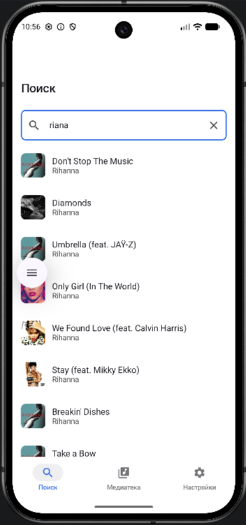
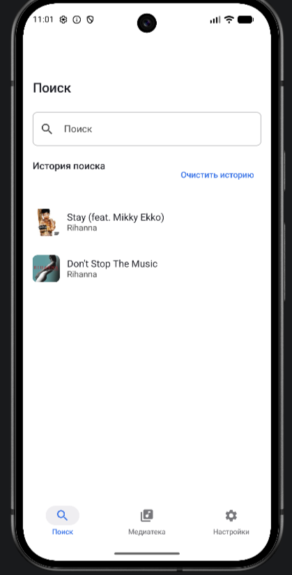
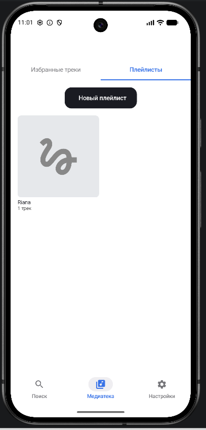
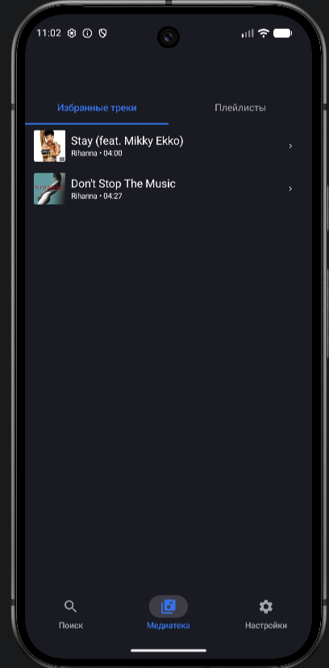
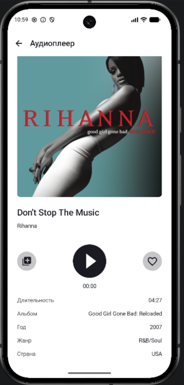
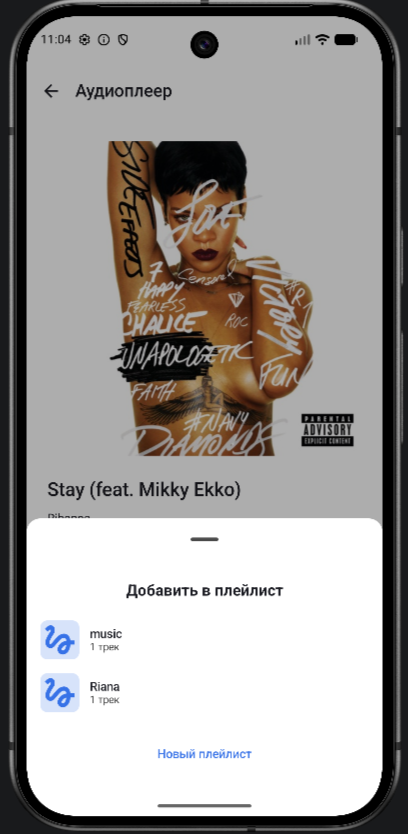
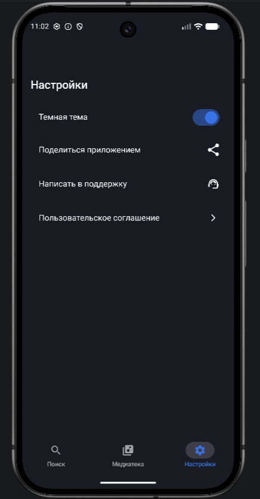
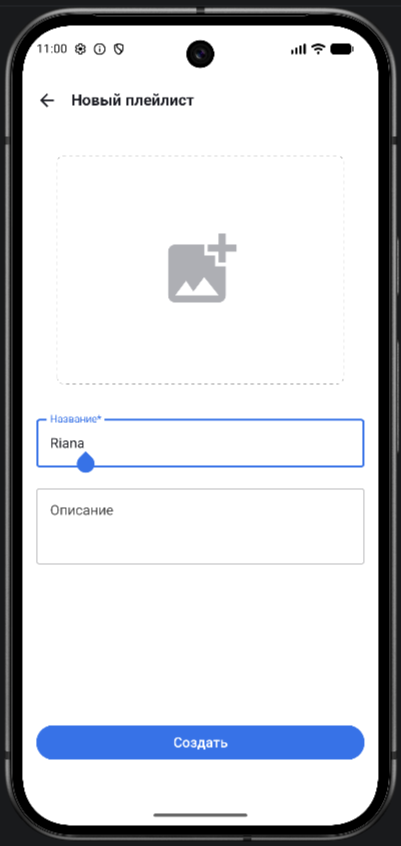
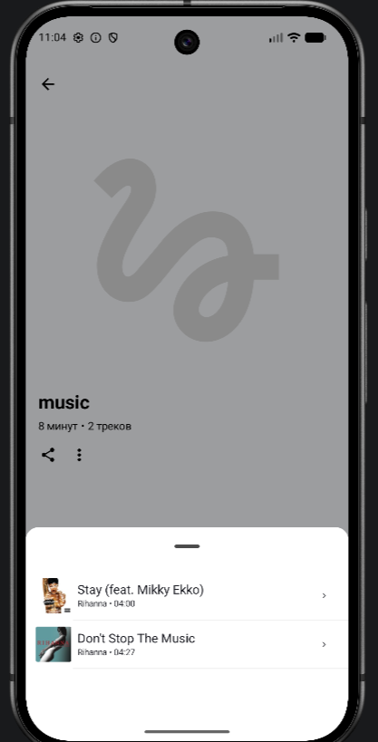

# PlaylistMaker

Приложение для поиска музыкальных треков через API iTunes и создания собственных плейлистов. Позволяет искать композиции, добавлять их в избранное, управлять плейлистами и делиться ими.

## Скриншоты

*   Экран "Поиск"
 
*   Экран "Медиатека" (Избранное и Плейлисты)
 
*   Экран "Аудиоплеер"
 
*   Экран "Настройки" (Темная тема)

*   Создание и редактирование плейлиста
  

## Технологии
*   **Язык:** Kotlin
*   **UI:** Jetpack Compose, Material 3
*   **Сеть:** Retrofit, Gson
*   **Хранение:** Room, SharedPreferences
*   **Внедрение зависимостей:** Koin
*   **Архитектура:** Clean Architecture, MVVM
*   **Навигация:** Navigation Component (Compose)
*   **Асинхронность:** Coroutines, Flow
*   **Загрузка изображений:** Coil, Glide
*   **Аудио:** MediaPlayer, Foreground Service

## Архитектура
Проект разделён на три слоя (Clean Architecture):

*   **`data`** — работа с API (Retrofit), базой данных (Room), SharedPreferences и маппинг данных.
*   **`domain`** — бизнес-логика (интеракторы) и модели данных.
*   **`presentation`** (UI) — экраны (Compose), ViewModel и состояния (StateFlow/LiveData).

## Мой вклад
*   **Поиск треков (Retrofit, Coroutines, Clean Architecture):** Реализован поиск с дебаунсом, обработка состояний (загрузка, успех, ошибка, пустой результат) и сохранение истории поиска в SharedPreferences.
*   **Медиатека (Room, Flow):** Реализованы CRUD-операции для избранных треков и плейлистов. Добавление/удаление трека из избранного и плейлистов с автоматическим обновлением UI через Flow.
*   **Экран плеера (MediaPlayer, Service):** Создан плеер с управлением воспроизведением (Play/Pause), Foreground Service для фонового воспроизведения и синхронизацией состояния с UI.
*   **UI и навигация:** Разработаны все экраны приложения на Jetpack Compose, настроен граф навигации, реализован Bottom Navigation Bar и обработка системной кнопки "Назад".
*   **Настройки:** Реализован переключатель темной темы с сохранением состояния в SharedPreferences и мгновенным применением без перезапуска Activity.
*   **Работа с файловой системой:** Реализована загрузка и сохранение обложек плейлистов во внутреннее хранилище приложения.
*   **Шеринг:** Реализована функция отправки плейлиста (текстовый список треков) через Intent.ACTION_SEND.
